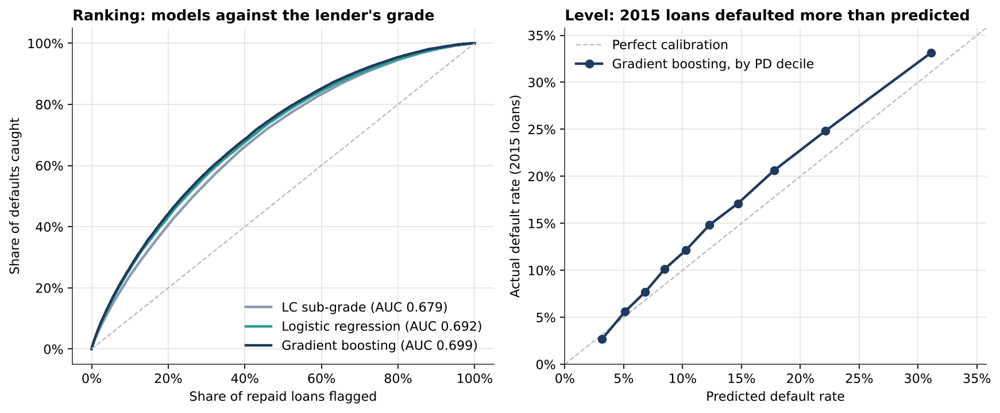
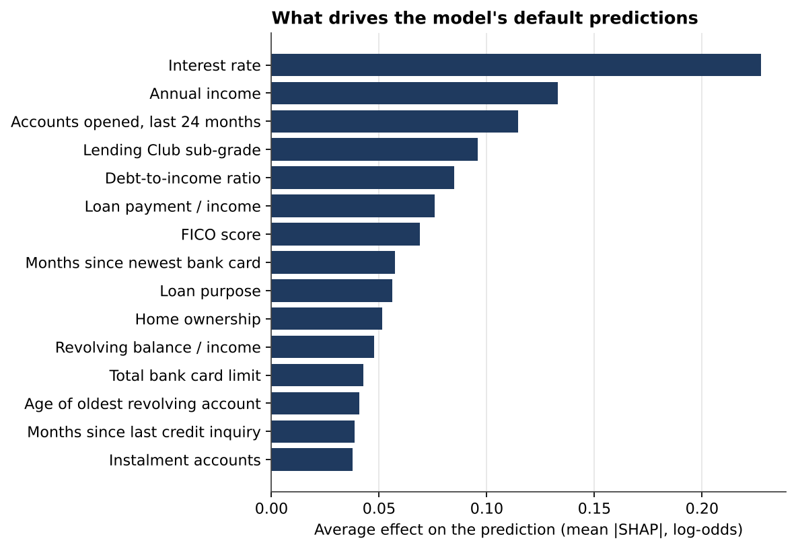
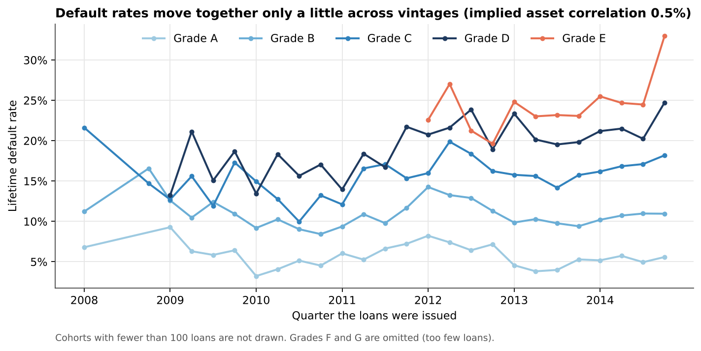
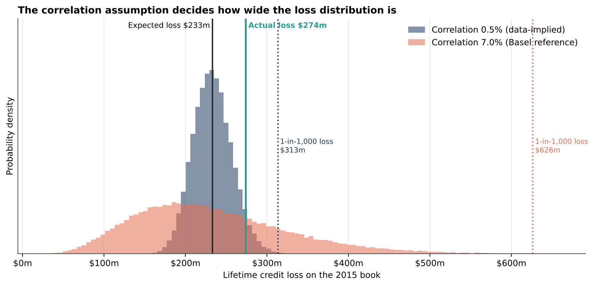
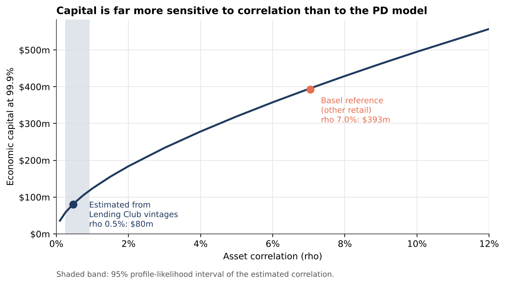
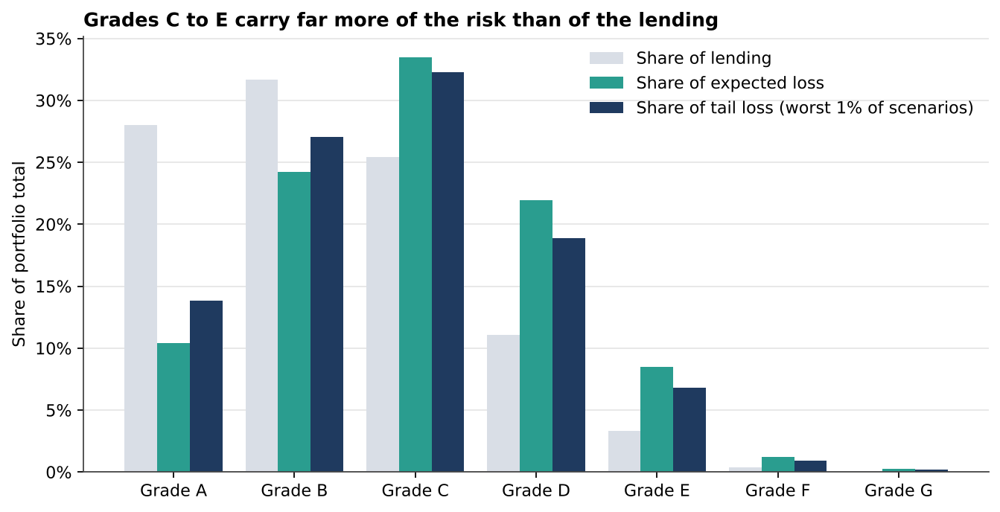
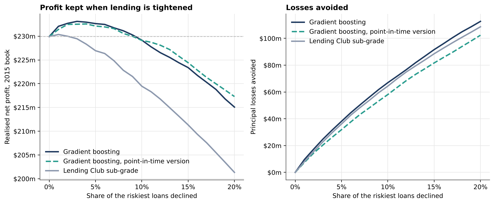

# From loan-level default prediction to portfolio capital

A machine learning model predicts which Lending Club borrowers will default. Those predictions then drive a simulation of losses across a $3.6 billion loan book, which answers three questions a lender's risk committee would ask: how much will we lose, how bad could it get, and which loans should we stop making.

Everything is tested out of time. Models are built on loans issued in 2012 to 2014 and judged on the 282,787 loans issued in 2015, whose outcomes are all known.

**[Open the interactive dashboard](https://seangoh97.github.io/credit-portfolio-risk/)** to replay the approval policy at any cut level, move the correlation assumption and watch the loss distribution and capital change, and compare the model variants.

## Summary

| Question | Answer |
|---|---|
| Does the model beat the lender's own risk grade? | Yes. AUC 0.699 against 0.679 on 2015 loans, a gain of 0.020 (95% interval 0.019 to 0.022). |
| How much did the model expect to lose? | $233m. The 2015 book actually lost $274m, because loans defaulted more often than in earlier years. |
| How much capital does the book need? | Between $80m and $393m, depending almost entirely on one assumption: how strongly defaults move together. |
| What is the model worth in money? | Declining the riskiest 10% of loans cuts losses by $67m (24%) and gives up $0.8m of profit. Making the same cut with Lending Club's grades gives up $10.4m. |

## The business question

A consumer lender wants to tighten its credit policy without throwing away profitable business, and wants to know how much capital its loan book ties up. Both questions need the same input, a default probability for every loan, but they use it differently. The approval decision needs loans ranked correctly. The capital number needs the level to be right, and it also needs a view on how many loans default at the same time in a bad year.

## Findings

### 1. The model ranks borrowers better than Lending Club's grade, and most of that survives a strict test



| Model | AUC | KS | Mean predicted default rate |
|---|---|---|---|
| Lending Club sub-grade | 0.679 | 0.262 | 13.0% |
| Logistic regression | 0.692 | 0.277 | 12.6% |
| Gradient boosting | 0.699 | 0.288 | 13.2% |
| Actual 2015 default rate | | | 14.9% |

The gain over the sub-grade is modest in AUC terms. Lending Club's grade is already a credit model built by a team with more data than is public, so beating it at all is the result. A version of the model that is not shown the grade or the interest rate still scores 0.688, which means the gain comes from the borrower data and not from repackaging the lender's own score.

There is a catch in how most projects on this dataset are validated. The model above learns from the final outcome of loans issued in 2012 and 2013, and a three-year loan issued in December 2013 does not reach its final outcome until 2016. A lender scoring applications in January 2015 could not have known it. Two extra models measure how much this matters:

| What the model was allowed to learn from | Training loans | AUC on 2015 loans |
|---|---|---|
| Final outcomes of 2012-13 loans (main model) | 143,892 | 0.699 |
| Only what was visible on 31 Dec 2014: whether each 2012-13 loan was 120+ days late within its first 12 months | 143,892 | 0.684 |
| Only loans that had fully matured by 31 Dec 2014 (issued 2007-11) | 29,095 | 0.666 |
| Lending Club sub-grade, for reference | | 0.679 |

The middle row is the realistic one. It still beats the grade, by a smaller margin. The bottom row does not: a model limited to a small set of old loans loses to the lender's grade. The honest reading is that the advantage depends on having recent performance data, and that the headline AUC of 0.699 is somewhat flattering.

The inputs that matter most are the interest rate, income, recent account openings and debt burden:



### 2. The forecast was too low, and the miss came from the level of defaults

The model expected the 2015 book to lose $233m of principal over its life (6.4% of the amount lent). It lost $274m (7.6%). Of the $41m gap, $35m is because more loans defaulted than predicted and $6m is because each default cost slightly more than in earlier years.

Ranking held up: the calibration chart above shows predicted and actual default rates rising together across all ten risk bands. The level did not. Default rates rose from 12.7% for 2012-13 loans to 13.7% for 2014 and 14.9% for 2015, and the deterioration was concentrated in the riskier grades. A model recalibrated on 2014 loans carries 2014's default rate forward and cannot see the next step up.

### 3. Capital depends far more on the correlation assumption than on the default model

A loss forecast is a single number. Capital is about the distribution around it, and the width of that distribution is set by how strongly loans default together. In the standard one-factor (Vasicek) model this is the asset correlation.

Rather than assume a value, the project estimates it from the data. Default rates of 30 quarterly vintages from 2007 to 2014 are fitted by maximum likelihood, which separates real co-movement from the noise expected in small cohorts.



The estimate is 0.47% (95% interval 0.25% to 0.93%). Annual cohorts give 0.44% and a simpler moment estimator gives 0.56%, so the result does not hinge on the method. It is far below the 7.0% that the Basel formula for "other retail" lending gives for this book.



| | Correlation estimated from the data (0.47%) | Basel reference (7.0%) |
|---|---|---|
| Expected loss | $233m | $233m |
| Loss exceeded once in 1,000 scenarios | $313m | $626m |
| Economic capital (that loss minus expected loss) | $80m | $393m |
| Capital as a share of lending | 2.2% | 10.9% |
| Where the actual 2015 loss falls in the distribution | 95th percentile | 71st percentile |

Two things follow.

First, the choice of default model barely moves capital. Swapping the gradient boosting probabilities for the logistic regression or the sub-grade ones moves capital by less than 5% either way: $79m to $85m, against $81m for the main model on the same semi-analytic calculation at the estimated correlation. Changing the correlation moves it almost fivefold.



Second, the data-implied correlation is probably too low. Under it, the loss that actually happened in 2015 was a 1-in-20 event. One year cannot settle the matter, but 2015 was not a recession, and an ordinary year should not land that far into the tail. The estimation window contains very few loans that lived through a downturn, so the estimate mostly describes how defaults co-move in calm conditions.

Where the risk sits by grade:



Grades C to E are 40% of lending, 64% of expected loss and 58% of losses in the worst 1% of scenarios (simulated at the Basel reference correlation). Grade A shows the opposite pattern on a smaller scale: 10% of expected loss but 14% of tail loss, because in a bad year safe borrowers deteriorate proportionally more than risky ones.

### 4. The model lets the lender cut risk almost for free

Suppose the lender decides to decline the riskiest share of applicants. The chart shows what the 2015 book would actually have earned, using realised cash flows, when "riskiest" is defined by the model and when it is defined by Lending Club's grade.



| Decline the riskiest 10% by | Losses avoided | Change in profit | Lending given up | Capital released |
|---|---|---|---|---|
| Gradient boosting model | $66.9m (24%) | -$0.8m (-0.3%) | $343m (9.5%) | 15% to 18% |
| Point-in-time version of the model | $58.1m (21%) | -$0.8m (-0.4%) | $302m (8.3%) | 13% to 15% |
| Lending Club sub-grade | $64.4m (24%) | -$10.4m (-4.5%) | $355m (9.8%) | 15% to 17% |

All three rankings remove a similar amount of loss. The difference is what it costs. The grade removes whole bands of high-rate loans, including many that would have repaid and paid a lot of interest. The model picks out loans that are riskier than their interest rate implies, so the declined loans contribute almost nothing to profit. The result holds for the point-in-time model, which uses only information available before the first 2015 loan was made.

At a 5% cut the model-based policy raises profit by $2.7m while avoiding $38m of losses; the grade-based policy lowers profit by $3.0m.

A second rule needs no chosen percentage: decline any loan the model expects to lose money. It turns away 1.1% of applicants ($36m of lending). Those loans defaulted at a rate of 39.6% and lost $1.8m after interest. The small size of this group shows that Lending Club's pricing covered expected losses for nearly every borrower, so the opportunity lies in ranking marginal loans better, not in finding a large pocket of bad ones.

Baseline for these comparisons: the 2015 book earned $229.9m over its life (6.35% of the amount lent), measured as cash received minus cash lent, before funding and servicing costs.

## Recommendation

1. **Use the model to tighten at the margin.** A cut of 5% to 10% of applicants, chosen by the model, removes 14% to 24% of credit losses and 8% to 18% of economic capital with no material loss of profit. Because the result also holds for the point-in-time model, it does not rest on hindsight.
2. **Do not set capital from the correlation observed in good years.** The estimate from the lender's own history gives $80m. The actual 2015 loss already sat at the 95th percentile of that distribution. A figure near the Basel reference is the safer planning number until the data includes a downturn.
3. **Recalibrate the level often and watch it.** The model's ranking was stable from 2013 to 2015. Its level was not, and that drift produced the $41m forecast miss. Tracking predicted against actual default rates on recent vintages (using early delinquency, which is visible within a year) would have flagged this well before the loans matured.

## How it works

1. **Data.** 36-month loans to individual borrowers issued from 2007 to 2015. Of 620,930 such loans, 2,438 made outside Lending Club's standard credit policy and 147 with no final outcome are dropped, leaving 618,345. Only 36-month loans issued by the end of 2015 are used because every one of them had matured by the time the data was published, so no default rate is biased by loans that are still running.
2. **Default model.** Gradient boosted trees (LightGBM) on 65 inputs known when the loan was funded. Trained on 2012-13 loans, with the number of trees chosen on the last three months of that window. Compared against a logistic regression and against Lending Club's sub-grade. State and zip code are left out because geography can stand in for protected characteristics.
3. **Recalibration.** Each model's output is passed through a two-parameter logistic map fitted on 2014 loans. This corrects the level without changing the ranking, and all three models get the same treatment.
4. **Loss given default.** The share of the original loan amount that is lost when a loan defaults, by grade, from 2012-14 defaults (45% for grade A rising to 61% for F and G).
5. **Correlation.** A binomial version of the Vasicek model fitted by maximum likelihood to default counts by vintage quarter and grade, with a profile-likelihood interval. The Basel reference value is the "other retail" correlation formula applied to each loan's annualised default probability and averaged by loan amount.
6. **Loss distribution.** A Monte Carlo simulation of all 282,787 loans individually over 20,000 scenarios. The economic factor is drawn by stratified sampling so that the extreme tail is covered evenly.
7. **Business impact.** Alternative approval rules are scored on the cash each loan actually paid.

The horizon throughout is the life of the loan. Expected loss here is a lifetime figure (the basis of CECL provisioning in the US), and the capital figures are for the whole life of the 2015 vintage, not for one year.

## Why the numbers can be trusted

- **Three independent calculations of the loss distribution agree.** The loan-by-loan simulation, a semi-analytic method that integrates over the economic factor, and the closed-form large-portfolio formula give 1-in-1,000 losses within 0.4% of each other.
- **The simulation engine is checked against the model's definition.** A test simulates correlated asset values directly and confirms the engine produces the same distribution. Another compares a large uniform portfolio with Vasicek's formula.
- **The correlation estimator recovers known answers.** Tests generate data with a known correlation and confirm the estimate and its interval. The estimate on real data is unchanged when the integration grid is doubled.
- **Leakage is guarded by tests.** One test asserts that no field recorded after funding appears in the feature list. Another overwrites every outcome field with garbage and confirms the features do not change.
- **The pipeline checks itself.** Each run performs 13 numerical checks and stops if any fails, including one that confirms the dashboard's curves match the figures quoted here. 62 unit tests run in about a minute without the data file.
- **Runs are reproducible.** Seeds are fixed. Two independent full runs, one from a fresh copy built straight from the raw file, produced byte-identical results, tables and charts.

Every number in this document comes from `outputs/results.json` or the CSV files in `outputs/tables`.

## Limitations

- **Approved loans only.** The data has no outcomes for rejected applicants, so the analysis can say what happens when credit is tightened, not when it is loosened.
- **One test year.** The loss distribution is compared with a single realised outcome. That is an illustration, not a statistical backtest.
- **The correlation estimate is fragile.** Vintages overlap in calendar time, so they are not independent observations and the stated interval is too narrow. Lending Club also changed what its grades meant over the years, which the model reads as co-movement. The window has few loans exposed to a recession.
- **One factor, fixed loss severity.** Real portfolios have more than one driver, and recoveries fall in downturns, which this model ignores. Both omissions make the capital figures too low.
- **The Basel correlation is a reference point, not a like-for-like benchmark.** It is defined for a one-year horizon and applied here to a lifetime one. The capital figures are economic capital under this project's assumptions, not regulatory capital.
- **Profit is simple.** Cash in minus cash out, with no discounting and no funding, servicing or acquisition costs. Including funding costs would strengthen the case for declining marginal loans, since they tie up funding for little return.
- **No fairness audit.** Dropping geography is a first step only. A model used for real credit decisions needs disparate-impact testing and reasons for each decline.

## Reproducing the results

Getting the data: download `accepted_2007_to_2018Q4.csv` (1.7 GB) from the Kaggle dataset "All Lending Club loan data" (`wordsforthewise/lending-club`) and place it in the `data` folder. The results here were produced from a copy of the same file hosted on Hugging Face (`codesignal/lending-club-loan-accepted`).

```
pip install -r requirements.txt
python -m pytest tests          # 62 tests, no data needed
python run_pipeline.py          # full run, about 12 minutes on one core
python build_dashboard.py       # rebuilds docs/index.html from outputs/
```

The first run reads the raw file and saves a compact extract, so later runs start faster. Peak memory is about 3 GB.

## Repository layout

```
run_pipeline.py            runs every step and writes outputs/
build_dashboard.py         turns outputs/ into the interactive dashboard
src/creditrisk/
    config.py              sample windows and the list of permitted inputs
    data.py                loading, outcome definitions, features, time split
    pd_model.py            the three default models, recalibration, metrics
    correlation.py         asset correlation estimators
    portfolio.py           Monte Carlo engine and analytic cross-checks
    business.py            loss given default, expected return, approval rules
    plots.py               figures
tests/                     62 tests on synthetic data
dashboard/template.html    the dashboard page, before the results are added
docs/index.html            the built dashboard, served by GitHub Pages
outputs/
    results.json           every reported number
    tables/                CSV tables behind the figures
    figures/               the seven charts above
```
